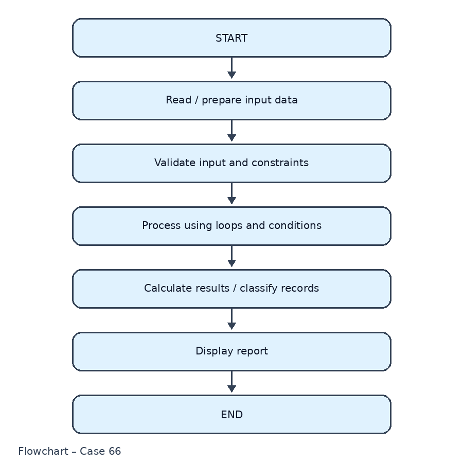
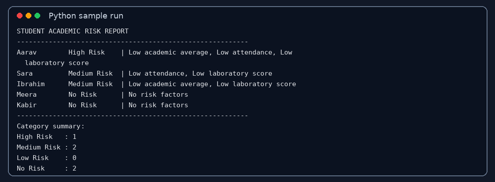

# Case Study 66: Student Academic Risk Classification

## 1. Problem Statement
Combine student marks, attendance, and laboratory scores to classify students into risk categories, identify simultaneous risk factors, and generate a summary.

## 2. Objectives
- Store student information in parallel lists.
- Check academic, attendance, and laboratory thresholds.
- Classify each student based on the number of risk factors.
- Summarize risk categories.

## 3. Assumptions
- Academic average below 40 is a risk factor.
- Attendance below 75% is a risk factor.
- Laboratory score below 40 is a risk factor.
- Three risk factors = High Risk; two = Medium Risk; one = Low Risk; zero = No Risk.
- All percentages and marks must be between 0 and 100.

## 4. Algorithm
1. Store student names, academic averages, attendance, and laboratory scores.
2. Validate that all lists have equal length and values are in range.
3. For each student, test the three risk conditions.
4. Count the risk factors and assign a category.
5. Record the factors responsible for the classification.
6. Count students in each category and display the report.

## 5. Flowchart
The diagram below shows the overall program flow. Detailed case-specific decisions are implemented in `solution.py`.



## 6. Pseudocode
```text
START
READ names, academic averages, attendance, lab scores
VALIDATE equal list lengths and values from 0 to 100
SET category counts to 0
FOR each student index
  CREATE empty risk_factors list
  IF academic average < 40, ADD academic risk
  IF attendance < 75, ADD attendance risk
  IF lab score < 40, ADD laboratory risk
  COUNT risk factors
  IF count = 3, category = HIGH
  ELSE IF count = 2, category = MEDIUM
  ELSE IF count = 1, category = LOW
  ELSE category = NO RISK
  UPDATE category count
END FOR
DISPLAY student-wise reasons and category totals
STOP
```

## 7. Python Source Code
See [`solution.py`](solution.py). The program uses Python built-in features and no third-party packages.

## 8. Test Cases

| Test | Input / condition | Expected result |
|---|---|---|
| High risk | Academic 35, attendance 60, lab 20 | 3 factors; High Risk |
| Medium risk | Academic 55, attendance 70, lab 30 | 2 factors; Medium Risk |
| Low risk | Academic 35, attendance 90, lab 80 | 1 factor; Low Risk |
| No risk | Academic 70, attendance 90, lab 80 | No Risk |
| Invalid attendance | Attendance 120 | ValueError is raised |

## Sample Output
The included program was run with the sample data in `main()`. The captured output is also saved as `sample_output.txt`.



## 9. Output Screenshot
This terminal-style screenshot is a generated capture of the sample program output. Run `python solution.py` to reproduce it.

## 10. Conclusion
The program combines academic, attendance, and laboratory indicators to classify students and explain risk factors. It uses parallel lists, loops, nested conditions, and summary counts.
